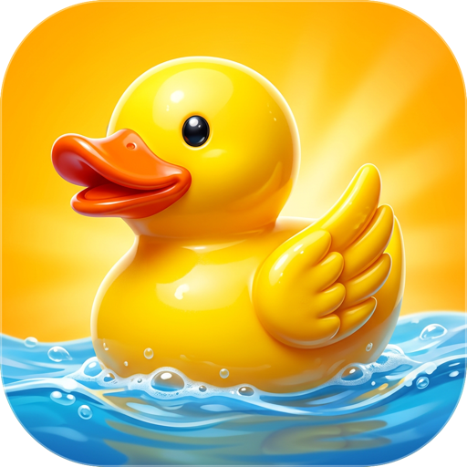
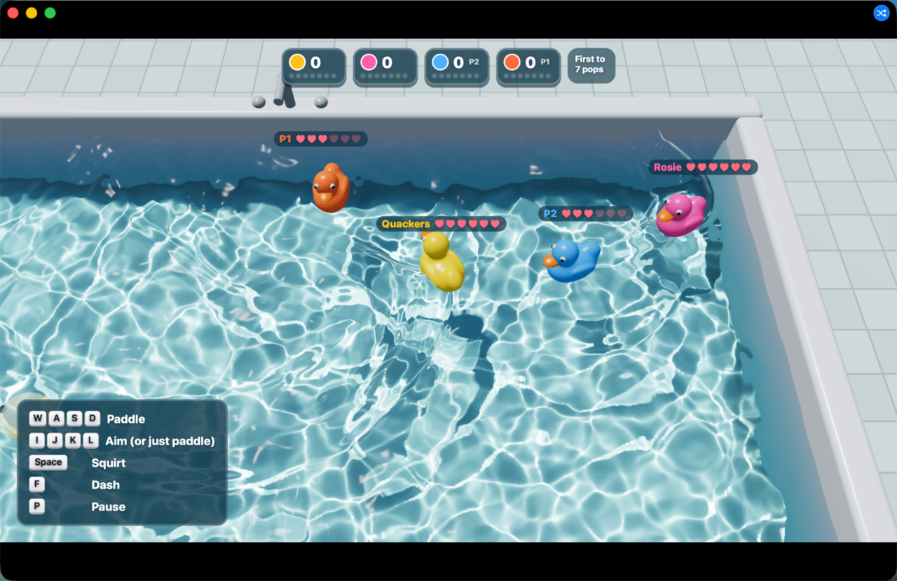
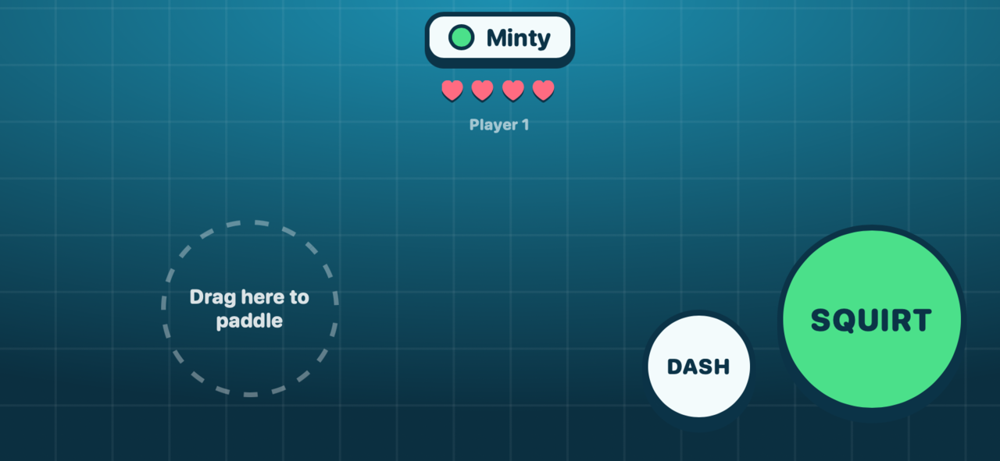

<h1 align="center">Duck Duel</h1>

A bathtub duck battle: squirt your friends' rubber ducks, on one screen or with phones.

First to pop 7 ducks wins. Play in a bathtub, a pond or a swimming pool, with bots filling in until at least four ducks are swimming.

## Play with your phone

Scan the code on the title screen with your phone's camera, on the same Wi-Fi, and tap SQUIRT. The match starts with your phone as a duck. Up to six ducks can play.

On the Mac: WASD paddles, IJKL aims, Space squirts, F dashes and P pauses.

## Open it in Lamp

[Lamp](https://lamp.dev) is a Mac app that builds apps from a description and changes them as you ask. [Open Duck Duel in Lamp](https://lamp.dev/?repo=https://github.com/lampdotdev/duck-duel&from=readme) for a copy of your own, to play and to change. Or, in Lamp, choose File → Open from GitHub… and paste `https://github.com/lampdotdev/duck-duel`.

Lamp builds the game on your Mac when you open it, so this repository holds only the game's own files.

## Credits

The water, caustics, ripples, sun and duck shape are adapted from [CAUSTIC//VOLUME](https://github.com/ScottieFox/caustic-volume) by ScottieFox, at commit `d87351bff198`, under the MIT license: see [its license](Licenses/ScottieFox/caustic-volume/LICENSE).
